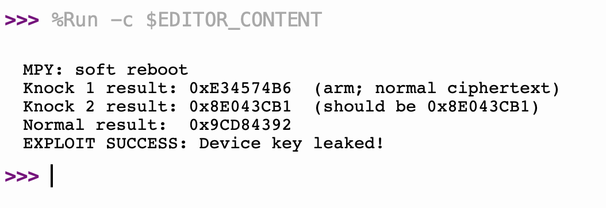

# Challenge 1 — Qualifying Trojan on the Hackster Board

**Status: demonstrated on hardware — device key `0x8E043CB1` exfiltrated.**

## Objective
Carry the qualifying-round hardware Trojan onto the physical Hackster iCE40-UP5K board and
demonstrate the exploit live. The Trojan and exploit logic are AI-generated per the competition
rules, and the full AI interaction log is retained.

## Target design
`crypto_core` is the accelerator recovered from the board's bitstream: a 32-bit block cipher
(12-round Feistel with key-dependent S-boxes) behind an SPI peripheral. `SCK` is the unified
system/SPI clock — the shift register and the engine both run in that one clock domain. The device
master key `0x8E043CB1` is embedded in the design. `rtl/spi_crypto_top.v` wraps the core and
exposes `SCK, MOSI, MISO, NORM_CS_N, START, ENC_DEC, BUSY`.

Interface sequence: shift in a 32-bit word (CS low, MSB first), raise CS, pulse `START`, clock
through `BUSY` (4 cycles), then read 32 bits back on `MISO`.

## The Trojan
- **Trigger** — a two-block "knock" in encrypt mode: `encrypt(0xDEADC0DE)` arms, `encrypt(0xFEEDFACE)`
  fires. Any other operand disarms; joint probability ~2^-64.
- **Payload** — key exfiltration: on the firing block the core returns the embedded key
  `0x8E043CB1` on `MISO` instead of the ciphertext.
- **Stealth** — a two-bit FSM + two 32-bit compares + a mux, inserted by AST manipulation into the
  clean core and gated by the `TROJAN_EN` parameter, so a `TROJAN_EN=0` twin is bit-identical to the
  clean design (verified 72/72 non-trigger transactions in simulation).

## AI pipeline
The Trojan was produced by a Claude-agent pipeline following the CSAW 2025 generate → insert →
verify → retry structure: Claude reads the recovered RTL and the exploit testbench, writes the
Trojaned `crypto_core.v`, runs the Icarus Verilog verifier, and iterates until the testbench reports
`TB_TROJAN: ALL PASS`. Every AI interaction is recorded to an append-only JSONL audit log.

## Build and flash
Tools: the Yosys OSS CAD Suite (iverilog, yosys, nextpnr-ice40, icepack) plus the board's RP2040
programmer.

    source ~/Downloads/oss-cad-suite/environment
    cp rtl/*.mem .
    iverilog -o sim_trojan tb/tb_trojan.v rtl/spi_crypto_top.v rtl/crypto_core.v && vvp sim_trojan
    yosys -p "read_verilog rtl/spi_crypto_top.v rtl/crypto_core.v; synth_ice40 -top spi_crypto_top -json design.json"
    nextpnr-ice40 --up5k --json design.json --pcf hackster.pcf --asc design.asc
    icepack design.asc design.bin
    python3 hackster-fpga-program.py w design.bin /dev/cu.usbmodem1301

The board is **not** flashed with `iceprog` (it has no FTDI chip); its onboard RP2040 programmer is
driven by `hackster-fpga-program.py`. The `.mem` S-box tables must be in the build directory so
`$readmemh` resolves at synthesis.

## Hardware setup
The board exposes two USB interfaces (identified via `system_profiler SPUSBDataType`):
- `/dev/cu.usbmodem1301` — Hackster programmer (UNSW CSE) — used for flashing.
- `/dev/cu.usbmodem1401` — MicroPython — used for the exploit and serial console.

Both stay connected. `exploit/exploit.py` runs on the MicroPython port via Thonny
(Tools → Options → Interpreter → MicroPython (Raspberry Pi Pico), Port = …1401).

## Running the exploit
Because the core is clocked entirely by `SCK`, the exploit must toggle `SCK` while `START` is
asserted and through the 4-cycle `BUSY` window before reading back — otherwise the engine never
advances and `MISO` merely echoes the input. The corrected `encrypt()` pulses `SCK` around `START`:

    start.value(1); clock(2); start.value(0); clock(8)   # then read 4 bytes

## Result (hardware)
Thonny serial console output:

    MPY: soft reboot
    Knock 1 result: 0xE34574B6  (arm; normal ciphertext)
    Knock 2 result: 0x8E043CB1  (should be 0x8E043CB1)
    Normal result:  0x9CD84392
    EXPLOIT SUCCESS: Device key leaked!

- **Knock 1** returns a normal ciphertext → the cipher operates correctly and the Trojan is dormant.
- **Knock 2** returns `0x8E043CB1` → the Trojan fired and exfiltrated the embedded device key.
- **Normal result** `0x9CD84392` matches the published golden vector for `encrypt(0x59C359C3)` →
  normal operation resumes; the Trojan leaves no residue.

The device key is leaked over the standard SPI read path with no change to normal functionality —
a stealthy, high-impact hardware Trojan demonstrated on the physical board.

**Direct proof — live capture of the exploit run on the board (Knock 2 leaks 0x8E043CB1 → EXPLOIT SUCCESS):**

## Troubleshooting notes (reproducibility)
- `iceprog` cannot see the board — it targets FTDI programmers; use `hackster-fpga-program.py` over
  the programmer USB port (`…1301`).
- Thonny "device busy / not responding" — point Thonny at the MicroPython port (`…1401`), not the
  programmer port.
- Exploit echoes the input — `SCK` must be clocked around `START` (the core is SCK-clocked).
- `$readmemh` all-`x` / wrong cipher — copy `rtl/*.mem` into the build directory before synthesis.

## Exploit Script

`pipeline/challenge_1/exploit.py` is the MicroPython script that triggers the Trojan from the RP2040.

### What it does
1. Resets the FPGA via RST_N
2. Encrypts 0xDEADC0DE (arms the Trojan) — returns normal ciphertext
3. Encrypts 0xFEEDFACE (fires the Trojan) — returns device key 0x8E043CB1
4. Encrypts 0x59C359C3 (proves normal operation resumed) — returns correct ciphertext
5. Prints EXPLOIT SUCCESS if the key was leaked, EXPLOIT FAILED otherwise

### How to run
Flash the FPGA first, then run the exploit via Thonny or mpremote:

    # Via Thonny: open pipeline/challenge_1/exploit.py, select MicroPython (Raspberry Pi Pico) on /dev/cu.usbmodem1401, click Run

    # Via mpremote:
    mpremote connect /dev/cu.usbmodem1401 run pipeline/challenge_1/exploit.py

### Expected output

    Knock 1 result: 0xE34574B6  (normal ciphertext)
    Knock 2 result: 0x8E043CB1  (should be 0x8E043CB1)
    Normal result:  0x9CD84392
    EXPLOIT SUCCESS: Device key leaked!
