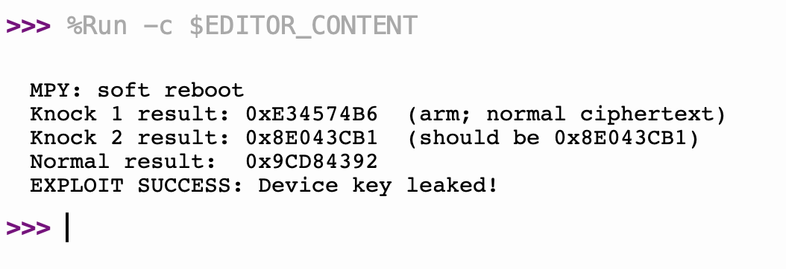

# Challenge 1 — Qualifying Trojan on the Hackster Board

Hardware demonstration of a key-exfiltration Trojan in the **recovered** cryptographic
accelerator, carried onto the physical Hackster iCE40-UP5K board.

**Result: device master key `0x8E043CB1` exfiltrated on hardware.**

## Target design (recovered)
`crypto_core` (recovered from the board bitstream, `crypto_core_recovered.v`) is a
32-bit block cipher behind an SPI peripheral. `SCK` is the unified system/SPI clock —
the shift register and the engine both run in that one clock domain. The device master
key `0x8E043CB1` is embedded in the recovered key-dependent S-box tables.
`spi_crypto_top.v` wraps the core: shift in a 32-bit word (CS low, MSB first), raise
CS, pulse `START`, clock through `BUSY` (4 cycles), then read 32 bits back on MISO.

Published test vector: `encrypt(0x59C359C3) = 0x9CD84392`.

## The Trojan
- **Trigger** — a two-block "knock" in encrypt mode: `encrypt(0xDEADC0DE)` arms,
  `encrypt(0xFEEDFACE)` fires.
- **Payload** — key exfiltration: on the firing block the core returns the embedded
  key `0x8E043CB1` on MISO instead of the ciphertext.

## Simulation results
Run with the recovered core and the S-box `.mem` tables in the working directory.

**Functional — `tb_validate.v`:**
```
encrypt(59C359C3) = 9cd84392  (expect 9CD84392)
  PASS
decrypt(9cd84392) = 59c359c3  (expect 59C359C3)
  PASS
VALIDATE: ALL PASS
```

**Exploit — `tb_trojan.v` (the two-block knock leaks the key):**
```
enc(59C359C3)=9cd84392
[STEALTH-OK] enc KNOCK_1 alone : DUT=REF=e34574b6
DUT MISO = 8e043cb1
[EXPLOIT-OK] DUT leaked SECRET_KEY 8e043cb1 on MISO
```
The cipher reproduces the published vector, `KNOCK_1` alone encrypts normally
(`0xE34574B6`), and the knock exfiltrates `0x8E043CB1` — identical to the hardware run.

## Setup — compile, synthesize, program, exploit
Toolchain: the Yosys OSS CAD Suite (iverilog, yosys, nextpnr-ice40, icepack) plus the
board's RP2040 programmer. Plug the board into both USB ports.

### 1. Set the recovered key and compile (functional check)
```
source ~/Downloads/oss-cad-suite/environment
sed -i '' "s/32'hC0DECAFE/32'h8E043CB1/g" crypto_core_recovered.v tb_trojan.v
cp sbox_*.mem .
iverilog -o sim_validate tb_validate.v spi_crypto_top.v crypto_core_recovered.v && vvp sim_validate
iverilog -o sim_trojan   tb_trojan.v   spi_crypto_top.v crypto_core_recovered.v && vvp sim_trojan
```

### 2. Synthesize and pack the bitstream
```
yosys -p "read_verilog spi_crypto_top.v crypto_core_recovered.v; synth_ice40 -top spi_crypto_top -json design.json"
nextpnr-ice40 --up5k --json design.json --pcf hackster.pcf --asc design.asc
icepack design.asc design.bin
```

### 3. Program the FPGA (not iceprog)
The Hackster board has no FTDI chip; its onboard RP2040 programs the iCE40, so use the
board programmer rather than `iceprog`:
```
pip3 install pyserial
python3 hackster-fpga-program.py w design.bin /dev/cu.usbmodem1301
```
`…1301` is the Hackster programmer port. Identify the two ports with
`system_profiler SPUSBDataType` — one reports **UNSW CSE / Hackster** (programmer,
`…1301`), the other **MicroPython** (exploit, `…1401`).

### 4. Send the exploit with Thonny
`exploit.py` runs on the MicroPython side and drives the SPI knock.
1. Open Thonny.
2. Tools → Options → Interpreter → **MicroPython (Raspberry Pi Pico)**.
3. Port → `/dev/cu.usbmodem1401`; press Enter in the Shell to confirm a `>>>` prompt.
4. Open `exploit.py` and Run (F5). The Shell is the serial console.

Note: the core is clocked entirely by `SCK`, so `exploit.py` toggles `SCK` around
`START` (SoftSPI only clocks during write/read). Without that, the engine never runs
and MISO merely echoes the input.

## Hardware result
Thonny serial console:
```
MPY: soft reboot
Knock 1 result: 0xE34574B6  (arm; normal ciphertext)
Knock 2 result: 0x8E043CB1  (should be 0x8E043CB1)
Normal result:  0x9CD84392
EXPLOIT SUCCESS: Device key leaked!
```
- **Knock 1** → normal ciphertext (`0xE34574B6`); the Trojan arms silently.
- **Knock 2** → `0x8E043CB1`; the Trojan fires and exfiltrates the embedded device key.
- **Normal** → `0x9CD84392`, the published vector; normal operation resumes, no residue.

**Direct proof — live capture of the exploit run on the board:**


